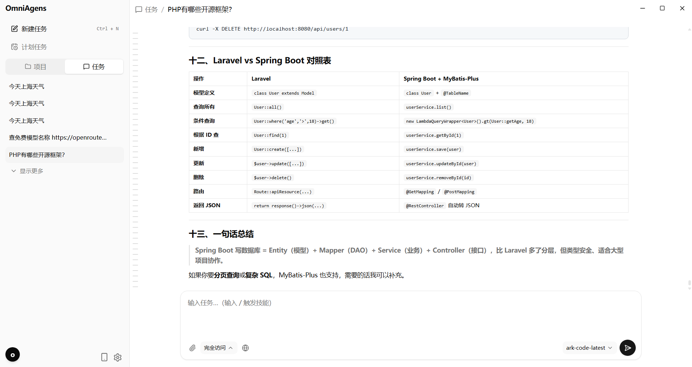
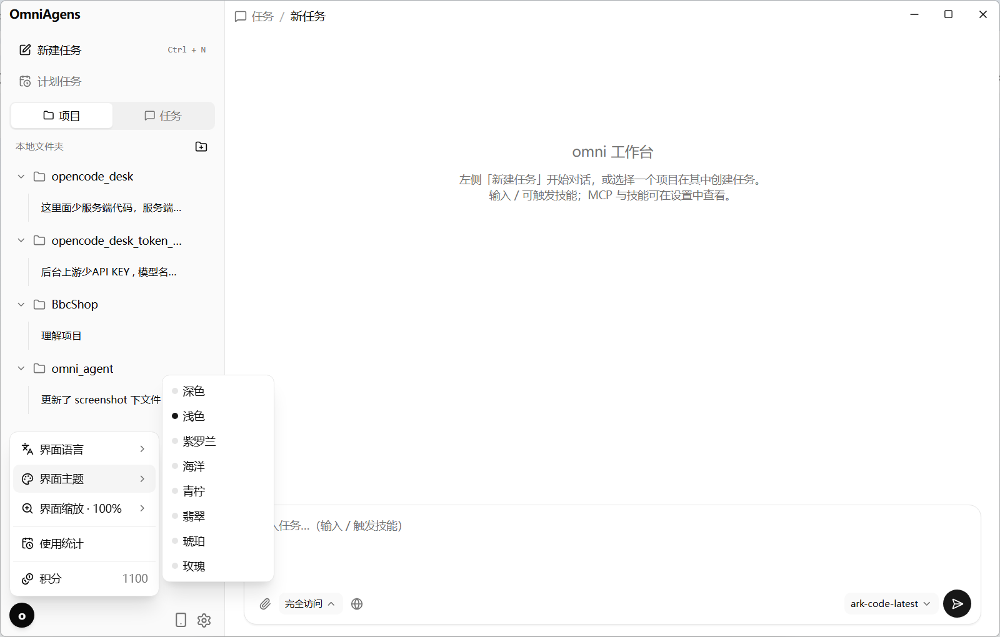
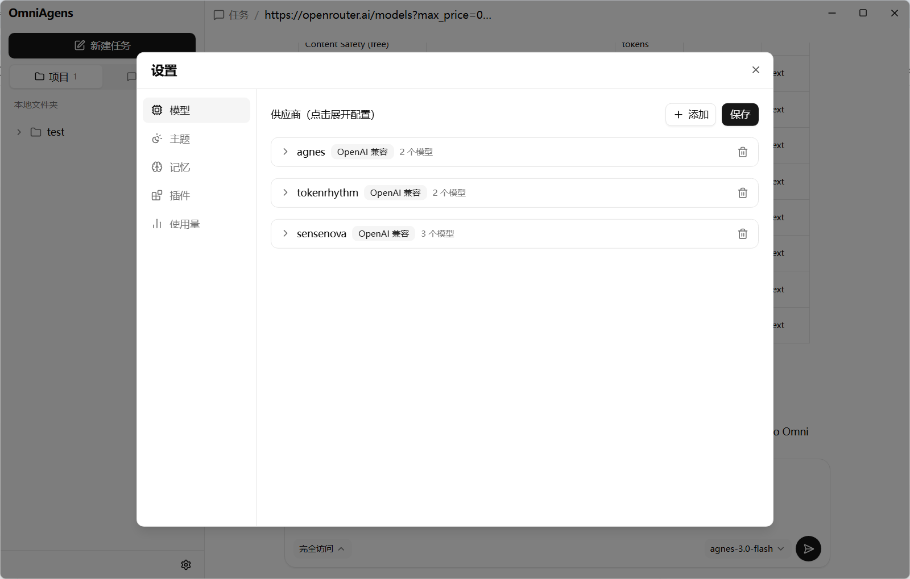
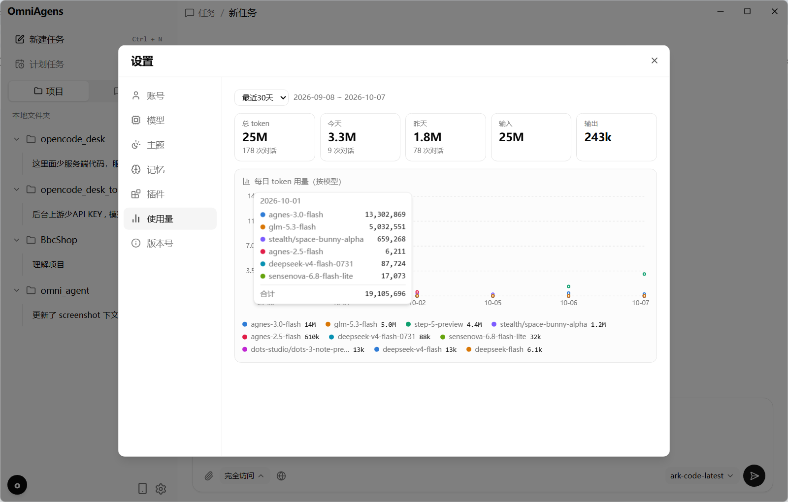
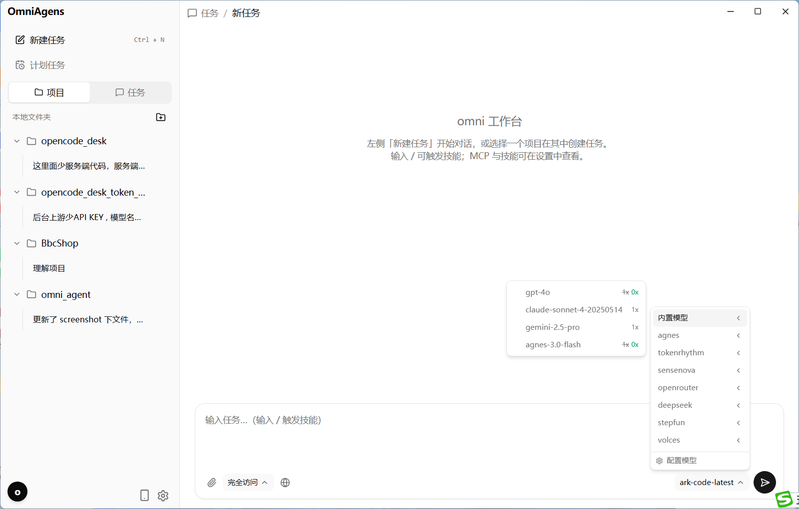

# omni — AI 编码智能体

桌面版 / 终端 TUI / 网页工作台，在本地与 AI 协作编程。
模型与供应商在桌面版「设置」里配置，开箱即用。

## 特性

- **TUI 聊天界面**：Bubble Tea 构建，消息流、流式输出、工具调用树（可折叠）
- **网页版工作台**：`--web` 或 TUI 内 `/webui` 打开（127.0.0.1，SSE 流式）
  - 左侧「任务 / 项目」：任务即发出去的一条条对话；项目是本地文件夹，各自管理任务
  - 任务列表默认显示 5 条，更多折叠展开
  - 设置：供应商与模型管理（URL / API Key / 多模型 / 上下文窗口 / 最大输出 / 输入类型 / 推理等级）、全局记忆、8 套主题、技能与 MCP 状态
  - 聊天底部可随时切换模型与 build/plan 模式，选择自动记住
  - 界面基于 [shadcn/ui](https://ui.shadcn.com/)，适配移动端（H5）
  - 任务与会话历史持久化在 `~/.local/share/omni/`
  - 桌面版：Electron 无边框窗口（自绘标题栏、原生文件夹选择），见 `webui/desktop`
- **移动端远程访问**：桌面端左下角手机图标开启后，手机扫码直接进同一份工作台（同一份任务与会话），免登录；默认关闭、每个请求校验设备 token、一键关停。开关与 token 落盘，重启后自动恢复
  - 二维码可一键换发，旧二维码、旧链接与已连着的手机立刻失效
  - `~/.local/share/omni/mobile.json` 的 `public_url` 填成 `https://<域名>` 后，扫码链接自动用域名而不是内网 IP，部署到公网不必改代码
- **计划任务**：到点（每 N 天 HH:MM）自动执行一次，错过的在 24 小时内自动补跑；支持手动执行、编辑、启停
- **MCP 支持**：`mcp_servers` 配置 stdio / streamable HTTP 服务器，远端工具以 `mcp__服务器__工具` 注入
- **技能（Skills）**：`SKILL.md` 定义技能，agent 自动调用，也可 `/技能名` 直接触发
- **全局记忆**：跨会话长期记忆，agent 可通过 `memory` 工具自动沉淀，设置面板可编辑
- **多 Provider**：OpenAI 兼容 / Anthropic / Gemini / Ollama 等
- **Agent 模式**：`build`（可写文件、执行命令）与 `plan`（只读）
- **非交互模式**：`--print "问题"` 供脚本与 CI 使用
- **omni-server 后台（可选）**：`server_cloudflare/` 的 Hono 服务（Cloudflare Workers + D1，也可 `npm start` 跑本地 Node+SQLite）——手机号验证码登录（测试模式 111111）、会员与积分、模型与供应商管理（倍率 / 限免 / 多供应商），界面基于 shadcn/ui

## 安装

```sh
go build -o omni .
```

需要 Node.js 的场景只有修改前端（`webui/frontend`）；仓库已提交构建产物，日常编译无需 Node。

## 快速开始

打开桌面版，在「设置 → 模型」里添加供应商（类型 / Base URL / API Key / 模型列表）即可开始；
聊天输入框底部可随时切换模型，选择自动记住。

```sh
./omni            # 桌面版 + 工作台（TUI 内输入 /webui 也可打开网页版）
./omni --web      # 只启动网页版工作台
```

## 配置文件

配置存放在 `~/.config/omni/config.json`（模板见 `config.example.json`，可用 `--config` 指定路径）。
供应商与模型、主题等都在桌面版「设置」里维护并自动写回，无需手动编辑；
`mcp_servers` 的结构见下节。

### 主题

「设置 → 主题」提供 8 套：深色 / 浅色 / 紫罗兰 / 海洋 / 天空 / 翡翠 / 琥珀 / 玫瑰。
彩色主题为浅色底，侧栏与右侧主区带同色系浅色效果。

### MCP 服务器

- stdio：`{"command": "...", "args": [...], "env": {...}}`，本地拉起子进程
- streamable HTTP：`{"url": "http://.../mcp"}`
- `"disabled": true` 可临时停用某个服务器

工具注入后命名为 `mcp__<服务器>__<工具>`；服务器发出工具变更通知时自动刷新（TUI 内 `/mcp` 查看状态）。

网页版「设置 → 插件 → MCP」里点「打开配置」会直接在文件管理器中打开 `config.json`，
按 `mcp_servers` 结构加服务器，改完点「刷新」触发重连。

### 技能（Skills）

目录约定（均为 `名称/SKILL.md`）：

- 全局：`~/.config/omni/skills/<名称>/SKILL.md`
- 项目：`<项目>/.omni/skills/<名称>/SKILL.md`（覆盖同名全局技能）

```markdown
---
name: review
description: 审查当前代码改动并给出风险与改进建议
---

请先用 git diff 查看当前改动，然后……
```

agent 在任务匹配技能描述时会自动调用 `skill` 工具；也可以直接输入 `/review` 触发。

网页版「设置 → 插件 → 技能」提供三种装法：

- **打开目录**：直接拉起系统文件管理器，把 `SKILL.md`（或整个技能文件夹）粘进去保存，回到界面点「刷新」即加载
- **粘贴导入**：把 SKILL.md 全文贴进文本框，导入时自动解析 frontmatter；没有 frontmatter 就从正文推断名称和描述
- **添加技能**：表单式新建，适合手写简单技能

### 全局记忆

文件：`~/.config/omni/memory.md`。内容注入每轮系统提示词，agent 可用 `memory` 工具追加/替换；
网页版设置面板可直接编辑。

## 命令行参数

| 参数 | 说明 |
|------|------|
| `--config <path>` | 配置文件路径 |
| `--model <name>` | 覆盖模型名 |
| `--mode <build\|plan>` | Agent 模式 |
| `--cwd <dir>` | 工作目录（默认当前目录） |
| `--unsafe` | 允许工具访问工作目录之外 |
| `--print "<query>"` | 非交互模式，单轮问答后输出并退出 |
| `--timeout 5m` | 非交互模式整体超时 |
| `--web` | 不进 TUI，直接启动网页版工作台 |
| `--no-open` | 配合 `--web`，不自动打开系统浏览器（桌面版/调试用） |
| `--version` | 打印版本 |

## 快捷键

| 按键 | 功能 |
|------|------|
| Enter | 发送消息 |
| Alt+Enter / Ctrl+J | 换行 |
| Esc | 取消当前生成 |
| Ctrl+C | 退出（生成中再次按键强制退出） |
| Ctrl+O | 展开 / 折叠工具调用 |
| Ctrl+R | 重新生成最后一条回复 |
| Ctrl+L | 滚动到底部 |

## Slash 命令

`/help` `/new` `/config` `/model <名称>` `/mode build|plan` `/skills` `/memory` `/mcp` `/webui` `/quit`
（外加已安装技能的 `/技能名`）

## 工具

| 工具 | 可写 | 说明 |
|------|:----:|------|
| read | 只读 | 读取文件（支持偏移与行数限制） |
| write | 写 | 整文件写入 |
| edit | 写 | 精确字符串替换 |
| bash | 执行 | 运行 shell 命令（默认 10s 超时） |
| grep | 只读 | 正则搜索 |
| glob | 只读 | 文件名模式匹配（支持 `**`） |
| skill | 只读 | 读取技能指令 |
| memory | 写 | 读写全局记忆 |
| `mcp__*` | 视服务器 | MCP 远端工具（plan 模式默认不可用） |

## 开发

```sh
go build ./...        # 编译
go test ./...         # 单元与集成测试
go vet ./...          # 静态检查
```

前端（webui/frontend，React + Vite + Tailwind + shadcn/ui）：

```sh
cd webui/frontend
npm install
npm run build         # 产物输出到 internal/webui/dist，由 go:embed 打进二进制
OMNI_URL=http://127.0.0.1:PORT npm run dev   # 调试：代理到正在运行的 omni
```

桌面版打包（webui/desktop）：

```sh
go build -o webui/desktop/bin/omni.exe .   # 先编译内核
cd webui/desktop
npm install
npm run dist        # 产出 NSIS 安装包（release/omni-Setup-x64.exe）
npm run dist:mac    # 产出 macOS dmg（未签名；须在 mac 上跑）
npm run dist:linux  # 产出 AppImage + deb（须在 Linux 上跑）
```

正式发布走 `.github/workflows/release.yml`：打 `v*` tag 即在 Windows / macOS / Linux
三平台各出双架构安装包（Windows NSIS、macOS dmg、Linux AppImage + deb）。

后台（`server_cloudflare/`，Hono + TypeScript，一套代码两种形态：Cloudflare Workers + D1，
或本地 `npm start` 跑 Node + `node:sqlite`）：

```sh
cd server_cloudflare
npm install
npm run build:web   # 后台前端产物 dist/（源码在 server_cloudflare/web/）
npm start           # 本地形态，http://127.0.0.1:35000
```

测试模式验证码 `111111`；不内置任何账号——`desk_users` 为空时第一个手机号验证码登录的即超管。
云端部署见 `server_cloudflare/README.md`。

## 目录结构

```
├── main.go              入口 / flag / 扩展装配 / TUI / --print / --web
├── config.example.json  配置模板
├── internal/
│   ├── config/          配置加载（providers / theme / mcp_servers）
│   ├── llm/             Provider 抽象（openai / anthropic / gemini）+ 解析
│   ├── tools/           工具实现与安全边界（支持动态注册）
│   ├── agent/           Agent 循环 / 模式 / 历史
│   ├── mcp/             MCP 客户端管理（stdio / streamable HTTP）
│   ├── skills/          技能（SKILL.md）加载
│   ├── memory/          全局记忆
│   ├── extras/          技能/记忆/MCP 聚合装配
│   ├── store/           任务与项目持久化
│   ├── tui/             Bubble Tea 界面
│   ├── webui/           网页版服务 + 内嵌前端 dist（含移动端 LAN 监听器）
│   └── ...
├── webui/frontend/      前端源码（React + shadcn/ui）
├── webui/desktop/       桌面版 Electron 壳
├── dev/                 自研 MCP 服务器源码（agnes / mimo / docx / pptx / xlsx / pdf）
├── cmd/                 辅助命令（shot_test 等）
└── server_cloudflare/   独立后台（Hono + TypeScript：Workers+D1 或本地 Node+SQLite）
    ├── src/             app.ts（路由）、desk.ts（桌面端手机号协议）、admin.ts（后台）、gateway.ts（网关计费）
    ├── web/             后台前端源码（React + shadcn/ui，产物 dist/）
    └── schema.sql       建表（含 desk_* 桌面端账号/积分账本）
```
